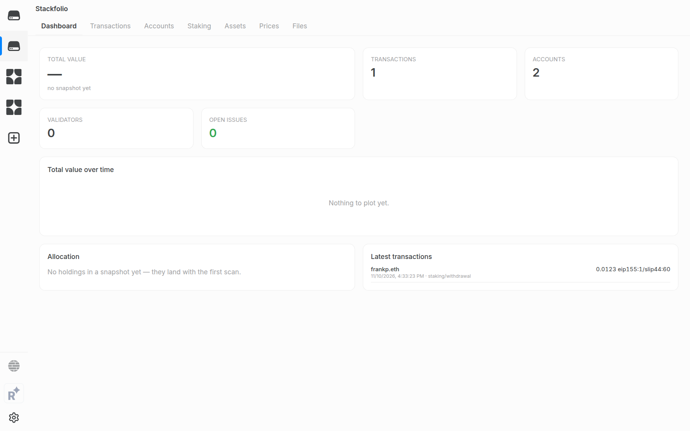
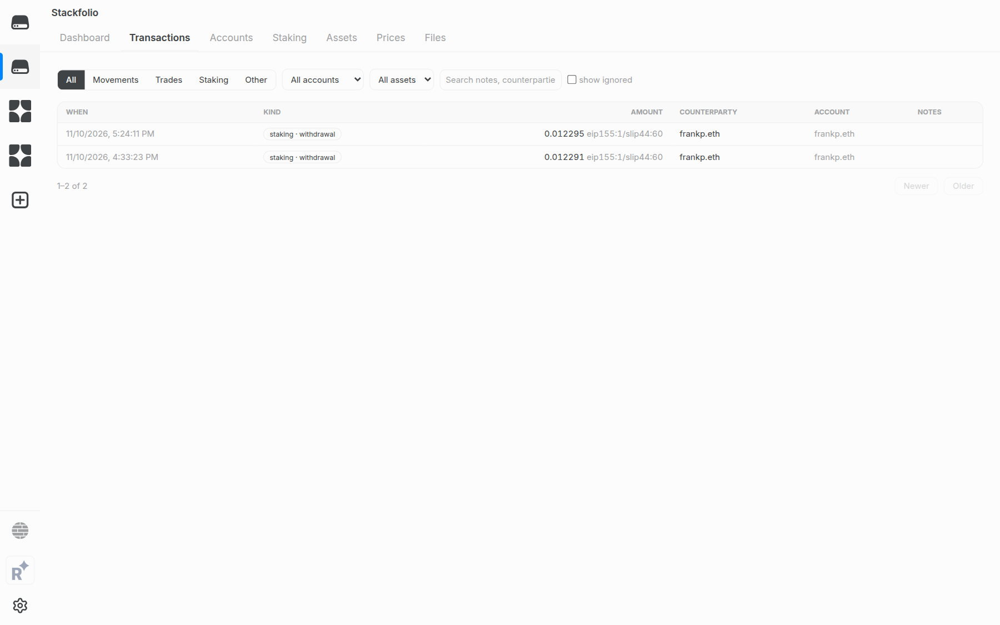
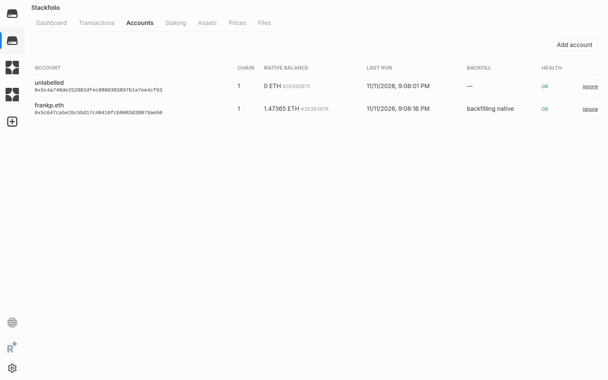

# Stackfolio

A personal crypto portfolio as a Powerhouse package: your documents hold
the data, workflows pull it in from the Etherscan API and your own
nodes, and the views in Connect render a full portfolio picture -
without a Python server.

## Views

Live against a local Geth node - real wallet, real chain data.

**Dashboard** - net worth from snapshots, allocation, latest events:



**Transactions** - the ledger, filterable; every row is a document event:



**Accounts** - balances, scan cursors, backfill progress, run health:



## What is in the box
| Piece | Role |
|---|---|
| `document-models/` | Five models: `portfolio` (the book), `wallet-account` (one address's ledger), `asset-registry`, `price-book`, `eth-staking` |
| `pieces/ethereum/` | A workflow piece: node scans (`scan-account-logs`, `scan-native-transactions`), state fetches, ENS lookups, CoinGecko prices, Prysm beacon reads, and the import actions that file everything onto documents |
| `processors/` | `portfolio-index` (the read model every view queries) and `stackfolio-reconciler`, which builds and repairs each portfolio's workflows |
| `subgraphs/portfolio-api/` | The GraphQL read API: accounts, ledger events, snapshots, staking, prices, issues - plus server-side ENS |
| `editors/stackfolio/` | The drive app: first-run wizard, dashboard, transactions ledger, accounts, staking, assets, prices |

## How a portfolio runs

1. **Wizard**: create/adopt the drive's singletons (portfolio, registry,
   price book), name who the book runs for (the grant), point at an
   execution node and a beacon node, add your first address (ENS names
   resolve through the node via `portfolioApi.ensAddress`).
2. **Reconciler** (a processor, sweeping every 5 minutes): without a
   grant or a reactor connection it only files issues. With both, it
   builds one live-scan workflow per wallet and a hourly price round,
   publishes them under your signature, and repairs them when they drift.
   The engine parks a workflow after a failed run; the reconciler notices
   the stopped progress marker (scan cursor, backfill cursor) and re-arms
   it, so a node hiccup costs one retry interval, not the portfolio.
3. **Live scan** (every 5 minutes): ERC-20 transfers, recent native
   blocks, head balance - imported onto the wallet's ledger; the
   portfolio's holdings, snapshots and issues follow from the index.

## Nodes and history

Portfolio chain data - history and live - comes from indexers with your
keys kept on the ethereum connection document, never echoed anywhere
else. Etherscan V2 answers the chains its free plan covers (Ethereum,
Polygon, Arbitrum, Linea, Celo, Sonic, World, and more); the Blockscout
gateway answers the ones Etherscan charges for and Blockscout serves
(OP Mainnet, Gnosis); and the Ankr multichain API fills the gaps both
others refuse for free (Base, BNB Smart Chain, Avalanche), including
each transaction's logs so ERC-20s ride along - its one honest gap is
internal contract traces, which imports report as skipped. Bitcoin is
watched separately (chain id 0): give a wallet an account **xpub** (or a
single address) and Stackfolio derives its BIP-84 receive and change
addresses and reads the confirmed chain from the public mempool.space
API - watch-only, so no private key ever leaves your machine. A chain
none of the three covers, and not a Bitcoin target, is reported as
unsupported instead of being imported half-way.
History imports from block 0, so no archive node is needed: every
wallet's complete lifetime lands in the ledger, and events are keyed by
transaction hash, so imports are idempotent and re-run safely. Your own
`geth --http` (127.0.0.1:8545) still serves the private parts - ENS
lookups, the validator's world - and the local beacon API
(127.0.0.1:5052) serves staking reads. Other than Etherscan, Blockscout,
Ankr, mempool.space (Bitcoin) and CoinGecko (prices), nothing talks to
the internet.

## Commands

```bash
npm run vetra           # switchboard + Connect dev environment (ph vetra)
npm run tsc             # type-check package and hosts
npm run lint:fix        # oxlint (type-aware) with fixes
npm run test:coverage   # vitest; reducers held to 95%+ coverage
npm run build           # build the library
```
